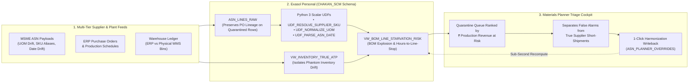

# Chakan Line-Feed & ASN Blast-Radius Engine

## Problem Statement

> **A lead materials planner at a mid-size Indian automotive manufacturer can't verify which Monday assembly runs face component stock-outs because dispatch updates from dozens of sub-tier MSME suppliers arrive in conflicting units, part codes, and date formats that rigid validation rules silently quarantine instead of linking to open purchase orders. If this worked, the planner would see the exact production lines and revenue threatened by each messy supplier record days in advance and resolve critical shortages before a single assembly station halts.**

---

## Why This Matters (Industry Evidence)

In discrete manufacturing clusters such as **Pune-Chakan**, **Chennai-Sriperumbudur**, and **Gurgaon-Manesar**, OEMs and Tier-1 plants run modern ERP systems while relying on thousands of Tier-2 and Tier-3 MSME vendors who send Advance Shipping Notices (ASNs) via spreadsheets, CSV exports, and lorry receipts (bilties).

Traditional data quality pipelines optimize for **database cleanliness over plant execution**: when a supplier file contains an unmapped SKU alias (`6204ZZ` instead of `ENG-BRG-6204-01`), bulk packaging units (`BAG_250` or `MT` instead of `EA` or `KG`), or mixed `DD/MM/YYYY` dates, the ingestion job drops the row into a dead-letter quarantine table. To IT, the ERP remains clean; to the materials planner, **a quarantined row is an invisible shipment or hidden short-shipment** that starves an assembly station mid-shift.

- **₹6.14 Lakh Crore (\$74.1B) Indian Auto-Component Ecosystem:** Supported by 850+ Tier-1s and **10,000+ sub-tier MSME suppliers** operating largely on fragmented, non-EDI dispatch workflows ([ACMA Annual Performance Review, FY24](https://acma.in/pdf/Ind%20Presentation%20FY24.pdf)).
- **69% Inbound Order Data Error Rate:** **69% of non-RFID inbound orders** shipped between suppliers and distribution/plant facilities contain data and inventory discrepancies ([GS1 US & Auburn University Study](https://documents.gs1us.org/adobe/assets/deliver/urn:aaid:aem:a8d86484-ffce-498d-8c59-fc1223437d58/Case-Study-Executive-Summary-EPC-RFID-Retail-Supply-Chain-Data-Exchange-Study.pdf)).
- **70% of Planner Time Lost to Spreadsheets:** **67.4%** of supply chain managers rely on spreadsheets ([Gartner / Adelante SCM](https://cashflowinventory.com/blog/supply-chain-statistics/)), spending up to **70% of their operational time** manually chasing and reconciling supplier data ([Gartner, 2024](https://www.supplychaindive.com/news/supply-chain-procurement-leaders-flocking-generative-ai-2024-Gartner/705306/)).
- **43.6% of Disruptions Originate in Sub-Tiers:** Only **28.2%** of enterprises have visibility into Tier-2 suppliers and **15.9%** into Tier-3 suppliers ([BCI Supply Chain Resilience Report, 2024](https://www.thebci.org/news/supply-chain-disruptions-drive-increased-tier-mapping-and-insurance-uptake.html)).
- **Catastrophic Downtime & Freight Penalties:** Unplanned line stoppages cost **\$260,000/hr** across cross-sector manufacturing and up to **\$2.3M/hr** in automotive assembly ([Siemens True Cost of Downtime, 2024](https://assets.new.siemens.com/siemens/assets/api/uuid:1b43afb5-2d07-47f7-9eb7-893fe7d0bc59/tcod-2024_original.pdf)), while emergency expediting commands a **3x to 5x freight premium** ([CPCON Group, 2026](https://cpcongroup.com/insights/article/spare-parts-inventory-management-guide/)).

---

## Solution Architecture on Exasol Personal

Instead of discarding malformed supplier rows into unlinked error logs, this platform performs **Blast-Radius-Aware Data Harmonization** inside **Exasol Personal**:



### Key Exasol Personal Capabilities Used
1. **Distribution-Aligned Schema Design (`src/exasol_engine/ddl_schema.sql`):**
   - Uses `DISTRIBUTE BY internal_part_num` and `DISTRIBUTE BY po_number_ref` across core tables (`ITEM_MASTER`, `BILL_OF_MATERIALS`, `PURCHASE_ORDER_LINES`, `WAREHOUSE_INVENTORY_LEDGER`, `ASN_LINES_RAW`) to co-locate joins inside Exasol.
2. **In-Database Python 3 Scalar UDFs (`src/exasol_engine/udfs_harmonization.sql`):**
   - `CHAKAN_SCM.UDF_NORMALIZE_UOM`: Converts packaging strings (`BOX_100`, `BAG_250`, `CRATE_40`, `CRATE_50`) and weight inversions (`MT` to `KG`, or `MT` to `EA` via component unit weight) into canonical `ITEM_MASTER.base_uom`.
   - `CHAKAN_SCM.UDF_RESOLVE_SUPPLIER_SKU`: Multi-emit Python UDF (`EMITS (resolved_part_num, sku_match_method, sku_confidence)`) resolving stripped hyphens, vendor catalog aliases, and token overlap against open POs.
   - `CHAKAN_SCM.UDF_PARSE_ASN_DATE`: Resolves `DD/MM/YYYY`, `MM/DD/YYYY`, ISO `YYYY-MM-DD`, and Unix epoch timestamps using supplier master format profiles.
3. **Analytical BOM Explosion & Phantom Inventory Views (`src/exasol_engine/blast_radius_marts.sql`):**
   - `VW_INVENTORY_TRUE_ATP`: Reconciles central ERP balances against physical WMS cycle counts to expose **Phantom Inventory** before calculating Available-to-Promise (ATP).
   - `VW_ASN_HARMONIZED_LINEAGE`: Uses `ROW_NUMBER() OVER (PARTITION BY ...)` to suppress duplicate EDI/CSV retransmissions and applies UDF harmonization alongside planner overrides.
   - `VW_BOM_LINE_STARVATION_RISK`: Explodes component requirements across active assembly lines, quantifying **Hours Until Line Starvation** and **₹ Production Output at Risk** before and after harmonization.

---

## Synthetic Data Disclosure

All datasets in this repository are **100% synthetic** and generated programmatically via `src/data_generator/`. No proprietary, confidential, or employer data is used. The data generator models realistic Indian automotive powertrain BOM structures (Euro-VI diesel engines, 6-speed AMT gearboxes, heavy rear axles, 200kW EV drive units) and six documented sub-tier supplier data anomalies:
1. **UOM Conversion Inversion** (`BOX_100`, `BAG_250`, `CRATE_50`, and `MT`-to-`EA` weight dispatches)
2. **Supplier SKU Identifier Drift** (`6204ZZ` vs `ENG-BRG-6204-01`, stripped hyphens, vendor prefixes)
3. **Date Format Ambiguity** (`DD/MM/YYYY` vs `MM/DD/YYYY` vs Unix epoch timestamps)
4. **Multi-Split Partial Shipments** (single PO split across multiple trucks masking a net short-shipment)
5. **Duplicate ASN Retransmissions** (repeated carrier payloads requiring window deduplication)
6. **Phantom Inventory Variance** (divergent ERP system on-hand vs. physical WMS bin counts)

---

## Repository Structure

```text
├── LICENSE
├── README.md
├── requirements.txt
├── .env.example
├── src/
│   ├── data_generator/
│   │   ├── erp_master_gen.py        # Pune-Chakan suppliers, items, BOMs, POs, inventory & schedules
│   │   ├── chaos_injector.py        # Inbound MSME ASN chaos generator
│   │   └── generate_all.py          # CLI utility to generate all CSV tables in data/raw/
│   └── exasol_engine/
│       ├── ddl_schema.sql           # Exasol table DDL with DISTRIBUTE BY keys
│       ├── udfs_harmonization.sql   # Exasol PYTHON3 scalar UDF scripts
│       ├── blast_radius_marts.sql   # Analytical views for ATP, ASN lineage & BOM starvation risk
│       ├── harmonizer_core.py       # Shared Python harmonization routines
│       └── db_client.py             # pyexasol loader, query runner & interactive override handler
│   └── app/
│       └── app.py                   # Streamlit Materials Planner Triage & Resolution Cockpit
└── tests/
    └── test_harmonization.py        # Unit tests for UDF logic and blast-radius calculations
```

---

## Setup & Usage

### 1. Install Dependencies
```bash
python -m venv .venv
# Windows PowerShell:
.venv\Scripts\Activate.ps1
pip install -r requirements.txt
```

### 2. Configure Exasol Personal Connection
Copy `.env.example` to `.env` and set your Exasol Personal instance credentials:
```bash
cp .env.example .env
```

### 3. Generate Synthetic Supply Chain & Chaos Dataset
```bash
python -m src.data_generator.generate_all
```

### 4. Run Automated Tests
```bash
python -m pytest -q
```

### 5. Launch the Materials Planner Triage Cockpit
```bash
streamlit run src/app/app.py
```

---

## License

Licensed under the [MIT License](LICENSE).
